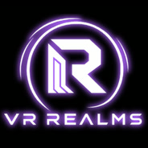

# VR Realms Creator Kit (app)

A small Windows app that gets you from nothing to making worlds and avatars for **VR Realms**: it checks what you
need, installs the Creator Kit, keeps it up to date, and opens it in Unreal Engine 5.8.



## Get it

- **Steam:** free for everyone who has VR Realms. In your Steam Library open the filter dropdown, pick **Tools**,
  then **VR Realms Creator Kit**, **Install**, **Launch**.
- **GitHub:** download from the [latest release](https://github.com/crazysketch/VRRealmsCreatorKitApp/releases/latest):
  - `VRRealmsCreatorKitApp-Setup.exe` installs the app for your Windows account (no admin rights needed).
  - `VRRealmsCreatorKitApp.exe` runs without installing.

The GitHub downloads are not code-signed yet, so Windows may show "Windows protected your PC". Click **More info**,
then **Run anyway**. The Steam version does not show this.

Needs Windows 10 or 11 (64-bit). The installer brings Microsoft Edge WebView2 if your PC does not have it; Windows 11
always has it.

## What it does

- **What you need:** one list with a button for each step: the Epic Games Launcher, Unreal Engine 5.8, the Creator Kit,
  Steam and VR Realms, SteamCMD for Workshop uploads, and signing SteamCMD in once.
- **Install the kit** into a folder you choose, or add a kit you already have, or find the kits on your PC.
- **Update the kit** safely: it shows what will change before anything changes. Files you changed are kept, your
  Community folder (your maps and avatars) is never touched, and every replaced file is backed up first.
- **Verify and repair** kit files that were damaged or deleted.
- **Updates itself:** one update button brings the new kit and the new app together; the app installs its new version and
  opens again by itself. A Steam copy is updated by Steam.
- **Open Creator Kit** in Unreal Engine 5.8 with one button.
- **My creations:** your worlds and avatars on the Workshop, with how many players visited each world or wore each
  avatar, who is in it right now, its rating, comments and subscribers, and whether the game shows it yet.
- **VR Realms right now:** players in the game and in the hub, a Play button, the next events, open polls and the world
  contest.
- **News**, a **Discord** button, guides and a log for when something goes wrong.

## Safety

- The kit is downloaded only from its [official releases](https://github.com/crazysketch/VRRealmsCreatorKit/releases),
  and a download is kept only when its checksum matches the one published with the release.
- The Epic Games Launcher comes only from Epic Games and SteamCMD only from Valve, and the app runs them only when
  Windows confirms they are signed by Epic Games or Valve.
- The app installs a new version of itself only when the installer carries our signature, checked against the key built
  into the app; anything else is refused.
- The app never asks for, sees or stores a password. Steam sign-in happens in SteamCMD's own window.
- It opens links only to vr-realms.com, our Discord, our GitHub, the Steam / Epic stores and Workshop pages.
- My creations reads the Steam account on this PC from Steam's own files (its public ID and profile name only) and asks
  vr-realms.com for public numbers. Private, friends-only and unlisted items are not listed.

## Help

- Guides: https://vr-realms.com/docs/ugc-tools.html
- Discord: https://discord.com/invite/qMZ7gZzg6A
- Email: support@vr-realms.com

## Building from source

You need [Node.js](https://nodejs.org) 20 or newer and [Rust](https://rustup.rs) (stable, MSVC).

```bash
npm install
npx tauri dev          # run it while you work on it
npx tauri build --no-bundle   # the exe, in src-tauri/target/release
```

Tests: `cargo test` in `src-tauri`. `cargo test -- --ignored` also installs, updates, verifies and repairs a kit
from the real GitHub releases in a temporary folder.

After changing dependencies, run `node scripts/third_party_notices.cjs` to rebuild `THIRD-PARTY-NOTICES.md`.

An installer of your own, without the updater's signature: `npx tauri build -c "{\"bundle\":{\"createUpdaterArtifacts\":false}}"`.

Official releases are made with `node scripts/release_build.cjs`: it signs the installer for the updater with the
private key (kept off GitHub), builds with the build machine's folder names left out of the exe and checks that they
are, then checks the installer's signature against the key built into the app and writes the `latest.json` uploaded
with the release.

## Credits

The design is based on the VR Realms UGC app by Haydar. Thank you!

## License

Copyright (c) 2026 Sketchy Realms. All rights reserved. The source is published so you can see what the app does, but
it is not open source: see [LICENSE.md](LICENSE.md). You may use the app and build it for yourself; you may not
redistribute it or reuse its code or branding elsewhere.

The app is built with open-source software that stays under its own licenses: see
[THIRD-PARTY-NOTICES.md](THIRD-PARTY-NOTICES.md). The Creator Kit itself has
[its own license](https://github.com/crazysketch/VRRealmsCreatorKit/blob/main/LICENSE.md).

VR Realms and the VR Realms logo are trademarks of Sketchy Realms. Unreal Engine, Epic Games, Steam and Valve are
trademarks of their owners; this app is not made, endorsed or supported by Epic Games or Valve.
